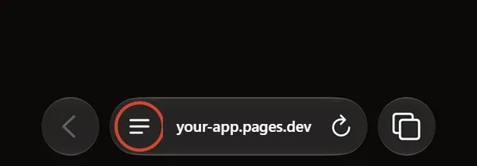
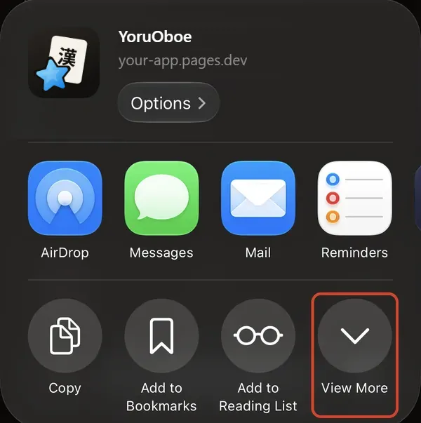
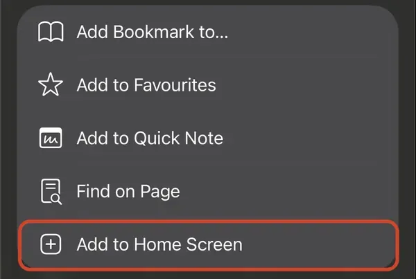
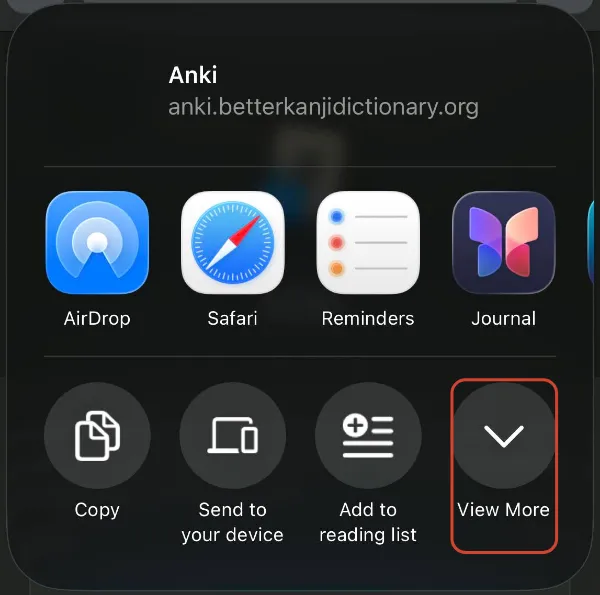
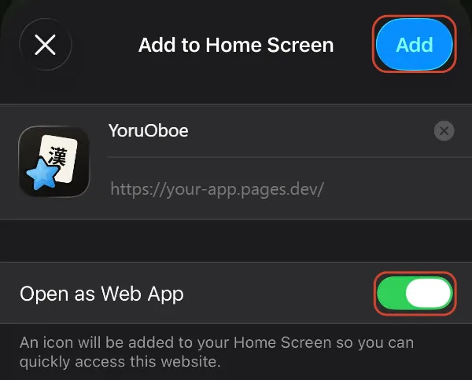

# Anki for the web

AnkiDroid, as an app you install from Safari. Your collection lives on the phone and
syncs with AnkiWeb (or your own sync server), like AnkiDroid and AnkiMobile. There is
no app server: the host only serves the app's files and passes sync requests on.

It is Anki itself rather than a re-implementation:

- **Anki's engine runs in the browser.** Its Rust core (rslib) is compiled to
  WebAssembly: scheduling, rendering, search, import/export, the database and sync are
  the same code desktop Anki runs. The changes needed for the browser are a patch on
  the release (`engine/anki-wasm.patch`, release in `ANKI_VERSION`).
- **Deck options, statistics, card info, the note editor, image occlusion, change note
  type and the importers** are Anki's own web pages, unpacked from the matching `aqt`
  wheel and shown in a frame. AnkiDroid shows the same pages.
- **Cards** are rendered by Anki's `reviewer.js`, as on desktop.
- **The rest** is AnkiDroid's layout and behaviour, rebuilt in React: deck list, study
  screen, browser, note types, settings, dialogs. `docs/ankidroid-parity.md` is the
  checklist it was built from, read out of AnkiDroid's source. It comes with AnkiDroid's
  font, Roboto (SIL Open Font License, `@fontsource-variable/roboto`), and moves like it:
  screens slide over each other, cards slide in, menus and dialogs grow from where they
  were opened, buttons ripple (`web/src/ui/motion.tsx`). The phone's Reduce Motion
  setting turns all of it off.

## How it fits together

```
iPhone (PWA)
  app (React) ──/api/… in-page──> local API (web/src/local)          the server's old routes
                                     │  protobuf, postMessage
                                     v
                                  Web Worker: Anki's engine (WebAssembly)
                                     │  SQLite + files in OPFS (IndexedDB if unavailable)
                                     │
                                     └─ sync: POST /aw/sync/…  ──https──> host ──> sync.ankiweb.net
host (Pi or Cloudflare Pages): the app's files, and /aw/<host>/… passed on to <host>.ankiweb.net
```

- **Why anything in between at all:** a web page may only call another site if that
  site allows it (CORS), and AnkiWeb doesn't. So the app sends sync requests to its own
  address, and the host passes them on unchanged (`deploy/serve.py` on the Pi, or a
  Cloudflare Pages Function). It stores nothing, but as the end of the HTTPS connection
  it can see what passes, including your AnkiWeb sign-in key: run it yourself.
- **AnkiWeb's terms** say its sync service is for the official Anki clients. The engine
  is Anki's own code and syncs as desktop Anki does, but it isn't an official client.
- **Another sync server:** Settings > Sync > Sync server. It must be reachable from the
  browser: at the app's address (`serve.py --sync-target`), or one that allows CORS.
- **Signing in** is AnkiDroid's: AnkiWeb email and password, sent to AnkiWeb (through
  the host); only the sync key is kept, on the phone. The app also works without an
  account, with a collection on the device only.
- **Everything works offline**: study, add and edit notes, Anki's pages, the browser.
  Syncing needs a connection; the app syncs on the sync button and pull-to-refresh,
  and on its own about as often as AnkiDroid: on opening, on leaving with changes, and
  on coming back 10 minutes or more after the last sync (`web/src/sync.ts`). It tells
  the sync server it is Anki's engine on `web`.
- **Cards run in a sandbox**: an iframe without same-origin, so a card's script can't
  reach the collection. Its media goes in as data URLs (`web/src/local/media.ts`).
- **AnkiDroid's JavaScript API** (`AnkiDroidJS`, `showAnswer()`, `buttonAnswerEase1()`,
  user actions, hints) works for templates written for AnkiDroid.

### Inside the browser

| Piece | Where |
|---|---|
| Engine build (wasm-bindgen exports: backend calls, async sync, files) | `engine/anki/rslib/wasm` (from the patch) |
| Files for the engine: OPFS pool for databases, a SQLite table for the rest | `rslib/io/src/vfs.rs` in the patch |
| The worker and its client | `web/src/engine/` |
| Anki's typed backend methods, generated from its build | `web/src/engine/generated/` |
| The app's API, answered locally (ports of the old server routes) | `web/src/local/` |
| Calls from Anki's pages (`/_anki/<method>`), as desktop's web server answers them | `web/src/local/pages.ts` |
| Service worker: the app offline, Anki's pages' URLs, media for them | `web/sw.template.js` |

Storage: OPFS sync access handles (Safari 16.4+) through `sqlite-wasm-rs`'s pool; where
those don't exist, IndexedDB, with the databases held in memory. Settings > Storage shows
which, the space used, and asks the browser to keep the data (granted to home-screen
apps). One copy of the app runs at a time (a second tab says so).

## Running it locally

    cd web && npm install
    python scripts/fetch_anki_web.py                 # Anki's pages, from the aqt wheel
    npm run dev                                      # http://localhost:5173

The dev server passes sync requests to a local sync server (`ANKI_SYNC_TARGET` to
change). For one, and test data:

    py -3.12 -m venv .venv && .venv/Scripts/python -m pip install -r requirements.txt
    SYNC_USER1=alice:secret SYNC_BASE=scratch/sync SYNC_PORT=27701 .venv/Scripts/python -m anki.syncserver
    .venv/Scripts/python tests/seed_collection.py http://127.0.0.1:27701/ alice secret

A production build, as the Pi serves it:

    cd web && npm run build && cd ..
    python deploy/serve.py --port 8780 --sync-target http://127.0.0.1:27701   # or no target: AnkiWeb

Browser tests (iPhone-sized, screenshots in `scratch/`; `ENGINE=webkit` is Safari's engine):

    BASE=http://127.0.0.1:8780 ENGINE=webkit ANKI_USER=alice ANKI_PASS=secret node tests/e2e.mjs
    … node tests/e2e_more.mjs
    BASE=http://127.0.0.1:8780 ENGINE=chromium … node tests/e2e_offline.mjs   # service workers: Chromium
    node tests/engine_smoke.mjs webkit                                       # the engine alone (dev server)

## Deploying

Two ways: your own Linux machine (a Raspberry Pi included), or Cloudflare Pages with no
machine at all. Either way the site must be served over HTTPS: the app's storage and
its service worker exist only on secure origins. Pick one per hostname.

What gets built is plain files (`web/dist`) plus the sync forwarder. The engine comes
prebuilt (`web/src/engine/pkg`), so building needs Node 20+ and Python 3, not Rust.

### On a Linux server or a Raspberry Pi

Any Linux with systemd: Raspberry Pi OS, Debian, Ubuntu… Nothing native runs on it,
but the build needs Node 20+: on a Pi, a 64-bit OS is the simple way to get it.

1. Install what the build and the service need:

       sudo apt install -y git python3 curl
       curl -fsSL https://deb.nodesource.com/setup_22.x | sudo -E bash - && sudo apt install -y nodejs

2. Get the code and set it up. This builds the app, writes `.env`, and installs one
   systemd service, `anki-web`, listening on `127.0.0.1:8767` (`deploy/serve.py`:
   the files, and `/aw/*` passed on to AnkiWeb):

       git clone <this repository> ~/anki-pwa && cd ~/anki-pwa
       bash deploy/pi-setup.sh

   To sync with your own sync server instead of AnkiWeb, set
   `SYNC_TARGET=http://127.0.0.1:27701` in `.env` and `sudo systemctl restart anki-web`.

3. Put it on the internet over HTTPS, one of:

   - **Cloudflare Tunnel** (what this Pi does, with BetterRTK's tunnel). In the Cloudflare
     dashboard: Zero Trust > Networks > Tunnels > the tunnel > Public Hostname > Add:
     subdomain `anki`, domain `betterkanjidictionary.org`, service
     `HTTP` `127.0.0.1:8767`. Cloudflare adds the DNS record.
   - **A reverse proxy on the machine**, with its own certificate. With Caddy, which gets
     one by itself:

         anki.example.org {
             reverse_proxy 127.0.0.1:8767
         }

4. Later updates: `bash deploy/update.sh` (pull, build, restart).

**Without Node on the machine** (this Pi): build on a PC and publish over SSH. From the
PC, with what you want deployed committed:

    bash deploy/publish.sh dani@192.168.1.30      # build, push, upload, restart

It pushes `main` to a bare repository on the machine (`~/anki-pwa.git`, cloned to
`~/anki-pwa`) and uploads `web/dist`. The first time, then run
`bash deploy/pi-setup.sh` on the machine (it asks for the sudo password) to install
the service; after that `publish.sh` alone deploys.

On Cloudflare (tunnel or Pages), keep **Rocket Loader** and **Bot Fight Mode** off for
the app's hostname: sync requests are scripted POSTs that can't answer a challenge.
Cloudflare's free plan also limits a request to 100 MB, which caps a full upload of a
collection; media syncs in small batches and is not affected.

### On Cloudflare Pages (no machine)

Cloudflare hosts the files, and a Pages Function (`deploy/cloudflare/functions/aw/`)
does the forwarding. Free for this use.

1. Build, on any computer with Node 20+ and Python 3:

       python3 scripts/fetch_anki_web.py
       cd web && npm ci && npm run build && cd ..

2. Deploy. The first time, `wrangler login` opens a browser to sign in to Cloudflare,
   and the deploy asks to create the project:

       cd deploy/cloudflare
       npx wrangler login
       npx wrangler pages deploy ../../web/dist --project-name anki

   It prints a `https://anki-….pages.dev` address, which already works.

3. Your own hostname: dashboard > Workers & Pages > anki > Custom domains > Set up a
   custom domain > `anki.betterkanjidictionary.org`. With the domain on Cloudflare, the
   DNS record is added for you. (Not while the same hostname points at a tunnel: one or
   the other.)

4. Later updates: steps 1 and 2 again.

`_redirects` and `_headers` (made by the build) do for Anki's pages what `serve.py`
does on a server.

## Installing on the iPhone

The app is meant to run from the Home Screen: there it opens full screen, keeps its
data, and works offline. Opened in a browser on an iPhone or iPad, the app shows these
steps itself, for the browser in use (the first time, then from the note on the deck
list and from Settings). It needs iOS 16.4 or later.

### Safari

1. Open **https://anki.betterkanjidictionary.org** and tap **•••** at the bottom right.
   (No ••• button? Tap **Share** and go to step 3.)

   

2. Tap **Share**.

   

3. Tap **View More**.

   

4. Tap **Add to Home Screen**.

   

5. Keep **Open as Web App** on, and tap **Add**.

   

### Chrome

1. Open **https://anki.betterkanjidictionary.org** and tap **Share**, in the address bar.

   

2. Tap **View More**.

   

3. Tap **Add to Home Screen**.

   

4. Keep **Open as Web App** on, and tap **Add**.

   

### Then

Open **Anki** from the Home Screen and log in with your AnkiWeb email and password, or
tap **Use without an account**. The first sync downloads your collection and its media;
after that the app works offline and syncs when it can.

The app on the Home Screen keeps its own data, apart from the browser's: whatever you did
in the browser tab before installing stays there.

Other browsers have Share in their own place (Firefox: in the ☰ menu), then the same
screens. Brave, and apps that open links inside themselves (Instagram, Messenger…),
cannot add to the Home Screen: open the address in Safari. The app says so when it is
in one of them.

Screenshots: Safari's are BetterRTK's install guide's, with its name and icon replaced
by this app's; Chrome's were taken with this app (`docs/install/source`). Both are cut
and ringed by `node scripts/make_install_shots.mjs`.

A Home Screen icon keeps the picture it had when it was added: after the icon changes,
delete it and add it again (the collection stays).

## Keep Anki versions together

The sync protocol changes between releases: the engine, desktop Anki and AnkiDroid
should be the same release (`ANKI_VERSION`).

### Rebuilding the engine (upgrading Anki)

Needs Rust (the toolchain Anki pins, with the `wasm32-unknown-unknown` target), clang
(for SQLite and zstd), and `wasm-bindgen-cli` at the version in Cargo.lock; see
`engine/env.sh` for where they are looked for.

    # edit ANKI_VERSION, then
    python engine/setup_source.py        # Anki's source + submodules + the patch, in engine/anki
    bash engine/build.sh                 # the engine, into web/src/engine/pkg
    python engine/gen_ts.py              # its TypeScript interface
    python scripts/fetch_anki_web.py     # the matching pages
    python engine/setup_source.py --diff # after fixing what didn't apply: the new patch

What the patch changes in rslib, in short: no sync server, threads or tokio runtime in
the browser build; sync over `fetch`, as async entry points; a file system for the
browser (`anki_io::fs`, `vfs.rs`) in place of std::fs; time from the JS clock;
journals kept in memory on the IndexedDB store.

## What's not here (yet)

- **Math in cards offline**: MathJax loads from the network inside the card's sandbox.
- **Engine size**: 19 MB (5.5 MB compressed), mostly every language's translations;
  downloaded once.
- **Add-ons**, as on AnkiDroid.
- **Reminders and widgets.** iOS allows web push for installed apps; not done yet.
- **Shared decks** open AnkiWeb's site; download the `.apkg` and import it.
- **LaTeX** images aren't generated (MathJax works); ones made on desktop sync in.
- **Background sync** doesn't exist for web apps on iOS: the app syncs while open.
- Anki's editor logs a harmless caret error in Safari when a field is focused
  (upstream, `safePlaceCaretAfterContent`).

## Layout

| Path | What |
|---|---|
| `engine/` | the engine: patch, setup and build scripts |
| `web/src/engine/` | the worker, its client, Anki's generated backend interface, the built engine |
| `web/src/local/` | the app's API, answered on the device |
| `web/src/screens/` | the screens, named as AnkiDroid's are |
| `web/public/` | the card frame, and the script put into Anki's pages |
| `deploy/` | `serve.py` and the Pi's service; the Cloudflare Pages Function |
| `scripts/` | Anki's pages from the aqt wheel; the icons and the install guide's screenshots (`make_*.mjs`) |
| `docs/` | the AnkiDroid parity checklist, how Anki's pages talk to their host, the Chrome install screenshots as taken |
| `legacy/` | the first, server-based version, for reference |
| `vendor/`, `reference/` | downloaded: Anki's pages; AnkiDroid's and Anki's source, for reference |
