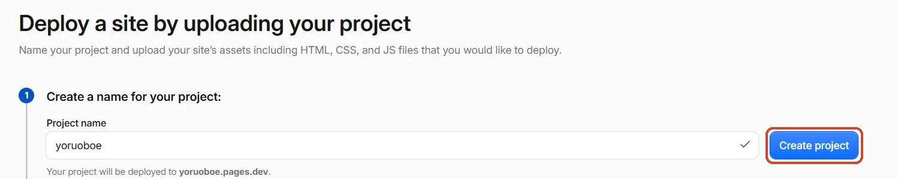
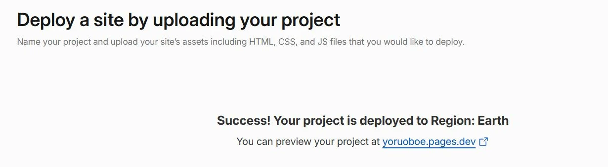

# YoruOboe

YoruOboe is a flashcard app for the iPhone. It uses the engine of Anki and the layout
of AnkiDroid.

Main features:

* Syncs to whatever server you need to sync to. Including AnkiWeb.
* Works in Airplane mode: the app keeps a local database and works offline. When you reconnect to a network, it syncs the changes
* Completely free on IoS, Optimized for IoS: I made this app because ankiweb did not get the job done for me. It is optimized for iPhone users.

YoruOboe is not in the App Store. Getting the app there is a pain in the *** and costs money I wanted to avoid paying. So it's a PWA instead.
100% of the needed functionalities are available in this PWA.

Since this is not an official distribution, I **highly recommend hosting your own Cloudflare Page for the app**.
The downside to making a PWA, as opposed to a normal app, is that the sync requests to AnkiWeb are made from the server's IP, not the phone's IP.
1 or 2 users using the same IP for syncs isn't suspicious, but 50 becomes a reason for a ban on your AnkiWeb account(s).

Hosting your own CloudFlare page for YoruOboe avoids that, because CloudFlare assigns your own personal server IP.

YoruOboe is not made by Ankitects (Anki) or by the AnkiDroid project.

> **As is: what you see is what you get.** Your copy does not update itself. There is no
> promise of new versions, and there is no support.

**Contents**

1. [Set up YoruOboe on Cloudflare Pages](#1-set-up-yoruoboe-on-cloudflare-pages)
2. [Install YoruOboe on your iPhone](#2-install-yoruoboe-on-your-iphone)
3. [More information](#3-more-information)

## 1. Set up YoruOboe on Cloudflare Pages

You need:

- A Cloudflare account. The account is free. You do not need a domain or a credit card.
  To make an account, go to [dash.cloudflare.com/sign-up](https://dash.cloudflare.com/sign-up).
- A computer with a web browser.

This procedure takes approximately 5 minutes.

### Step 1: Download the app

1. Go to [Releases](https://github.com/CreeperBeatz/yoruoboe/releases/latest).
2. Under **Assets**, download `yoruoboe-<version>.zip`.
3. Do not unzip the file.

### Step 2: Open Workers & Pages

1. Sign in to the [Cloudflare dashboard](https://dash.cloudflare.com).
2. In the search box, type `pages`.
3. Select **Workers & Pages**.
4. Select **Create application**.

### Step 3: Go to the Pages workflow

Cloudflare shows options to make a Worker. Do not select these options.

1. Find the text *Need to use the legacy Pages workflow?* at the bottom of the page.
2. Select **Continue to Pages**.

### Step 4: Select drag and drop

1. Find **Drag and drop your files**.
2. Select the **Get started** button next to it.

### Step 5: Give the project a name

1. In **Project name**, type a name. For example, type `yoruoboe`.
2. Make sure that a green check mark shows. The check mark tells you that the name is
   available.
3. Select **Create project**.

> **NOTE:** The name becomes the address of your app: `https://<name>.pages.dev`.

### Step 6: Upload the zip file

1. Drag the zip file from step 1 into the upload box.
2. Wait for the message *All files were successfully uploaded*.
3. Select **Deploy site**.

> **NOTE:** A yellow message says *Specifying a _routes.json is an experimental
> feature*. This is correct. The app needs this file for sync.

### Step 7: Get the address of your app

1. Wait for the message **Success!**.
2. Write down the address. For example: `https://yoruoboe.pages.dev`.
3. Go to [Install YoruOboe on your iPhone](#2-install-yoruoboe-on-your-iphone).

> **NOTE:** A new address can need 1 or 2 minutes before it opens.

## 2. Install YoruOboe on your iPhone

You need:

- An iPhone or an iPad with iOS 16.4 or later.
- The address of your app from [part 1](#1-set-up-yoruoboe-on-cloudflare-pages).

Use Safari or Chrome. The screenshots show the address `your-app.pages.dev`. Your
address is different.

> **NOTE:** When you open the address in a browser on the iPhone, the app also shows
> these steps.

### Safari

1. Open the address of your app in Safari. Tap **☰** on the left side of the address
   bar.

   If there is no ☰ button, tap **•••** at the bottom right. If there is no •••
   button, tap **Share** and go to step 3.

   

2. Tap **Share**.

   

3. Tap **View More**.

   

4. Tap **Add to Home Screen**.

   

5. Make sure that **Open as Web App** is on. Tap **Add**.

   

### Chrome

1. Open the address of your app in Chrome. Tap **Share** in the address bar.

   

2. Tap **View More**.

   

3. Tap **Add to Home Screen**.

   

4. Make sure that **Open as Web App** is on. Tap **Add**.

   

### Start the app

1. Open **YoruOboe** from the Home Screen.
2. Do one of these steps:
   - To sync with AnkiWeb, log in with your AnkiWeb email and password.
   - To use the app without AnkiWeb, tap **Use without an account**.

The first sync downloads your cards and media. After the first sync, the app also works
offline.

> **NOTE:** The app on the Home Screen keeps its data apart from the browser. Data from
> the browser tab does not go into the app.

> **NOTE:** Brave cannot add apps to the Home Screen. Apps that open links in their own
> browser (for example Instagram and Messenger) also cannot. Open the address in Safari.

## 3. More information

### Use your own domain

1. In **Workers & Pages**, select your project.
2. Select **Custom domains** > **Set up a domain**.
3. Type the hostname. For example, type `yoruoboe.example.org`.
4. Select **Continue**.
5. If the DNS of your domain is not on Cloudflare, add the CNAME record that Cloudflare
   shows.

> **CAUTION:** The data of the app belongs to its address. At a new address, the app
> starts empty. If you use AnkiWeb, sync again to get your cards back.

### Install a newer version

1. Download the new zip file from
   [Releases](https://github.com/CreeperBeatz/yoruoboe/releases/latest).
2. In **Workers & Pages**, select your project.
3. Select **Create a new deployment** > **Production**.
4. Drag the new zip file into the upload box.

The iPhone gets the new version after you open the app two times.

### If sync does not work

- If you use your own domain, set **Rocket Loader** and **Bot Fight Mode** to off for
  that domain. These features stop the sync requests.
- On the free plan, Cloudflare accepts a maximum of 100 MB in one request. This limit
  applies to the first full upload of a large collection. Media is not affected.

### Keep Anki on the same version

Use desktop Anki and AnkiDroid version 26.09.x. Other versions can fail to sync with
YoruOboe.

### Privacy and AnkiWeb

- Your cards and media stay on your phone. YoruOboe has no server that keeps your data.
- Your copy on Cloudflare sends the sync requests to AnkiWeb. Your copy can see your
  AnkiWeb sign-in key. For this reason, use only a copy that you control.
- The terms of AnkiWeb say that its sync service is for the official Anki apps.
  YoruOboe uses the code of Anki, but it is not an official app. You use AnkiWeb with
  YoruOboe at your own risk.
- You can use a different sync server: **Settings** > **Sync** > **Sync server**.

### What the app can do

- Study, add notes, edit notes, and search, also offline.
- Use the deck options, statistics, card info, note editor and image occlusion pages
  of Anki.
- Answer a card with a swipe: left for Again, right for Good, up for Easy, down for Hard.
- Import and export `.apkg` and `.colpkg` files.

### Known limits

- Math in cards (MathJax) needs an internet connection.
- The app does not support add-ons.
- The app does not send reminders, and it has no widgets.
- The app syncs only when it is open. iOS does not let web apps sync in the background.
- **Shared decks** opens the AnkiWeb site. Download the `.apkg` file and import it.
- The app does not make LaTeX images. LaTeX images from desktop Anki sync correctly.
- The first download of the app is approximately 10 MB.

### For developers

How the app works, how to run it, the tests, and how to deploy it on a Raspberry Pi:
see [docs/development.md](docs/development.md).

## License

AGPL-3.0 (see `LICENSE`). Anki is © Ankitects Pty Ltd and contributors, AGPL-3.0.
AnkiDroid is GPL-3.0. If you give other people access to your copy, the AGPL tells you
to offer them the source code. A link to this repository is sufficient if you did not
change the code.
